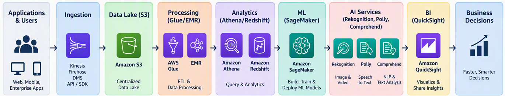

# AWS AI/ML and Analytics Services

## Analytics Services
   1. Amazon Athena
   2. Amazon Kinesis
   3. Redshift
   4. Amazon QuickSight
   5. AWS Glue

## Machine Learning Platforms
   1. Amazon SageMaker
## AI Services
   1. Amazon Lex `Conversational AI/ chatbot engine`
   2. Amazon Polly `Text-to-speech`
   3. Amazon Rekognition `Image and Video Analysis`
   4. Amazon Comprehend `NLP and sentiment analysis`
   5. Amazon Transcribe `speech-to-text`
## Analytics Workflows
   1. **Data collection/ingestion**
    Data ingestion refers to collecting data from sources such as:
     • IoT devices
     • Applications
     • Logs
     • Databases
     • Streaming events
      - **Amazon Kinesis** – real-time data streaming
      - **AWS DataSync** – data migration
      - **AWS Snowball** – large-scale data transfer
      - **Amazon MSK (Kafka)** – managed streaming platform
   2. Data storage
        - **Amazon S3** – data lake storage
        - **Amazon Redshift** – data warehouse
        - **Amazon DynamoDB** – NoSQL data
        - **Amazon RDS** – relational database
   3. Data processing
      - **AWS Glue** – serverless ETL
      - **AWS Lambda** – event-based processing
      - **Amazon EMR** – big data processing (Hadoop/Spark)
   4. Analytics queries
       - **Amazon Athena** – SQL queries on S3
       - **Amazon Redshift** – large-scale data warehouse
       - **Amazon OpenSearch** – log analytics and search
   5. Machine Learning training
      - **Amazon SageMaker** - `Data preparation, Model training, Model tuning, Deployment, Monitoring`   
   6. Visualization and reporting
      - Amazon QuickSight `dashboards, reports, ML-powered insights, embedded analytics`
   
## Examples

